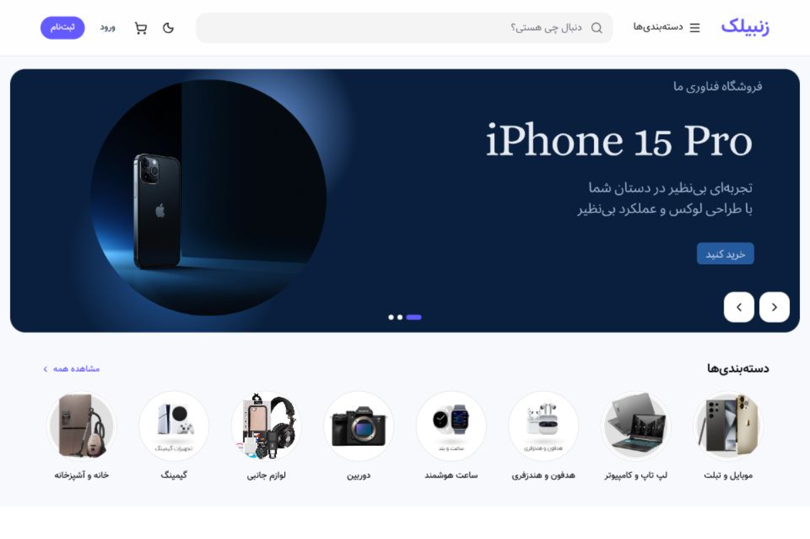

# Zanbilak E-commerce

A full-stack e-commerce application built with React, Vite, Express, Prisma, and PostgreSQL.

## Preview



## Features

- Product listing, search, filtering, and product details
- Shopping cart, checkout, payments, and order tracking
- User authentication and profile management
- Admin dashboard for managing products, categories, orders, and users
- Image uploads with Cloudinary integration
- Responsive design and dark mode
- PostgreSQL database with Prisma ORM

## Tech Stack

**Frontend**
- React
- Vite
- TypeScript
- Tailwind CSS

**Backend**
- Node.js
- Express
- TypeScript
- Prisma ORM
- PostgreSQL

**Deployment & Services**
- Vercel
- Supabase
- Cloudinary

## Getting Started

### Prerequisites

- Node.js 20+
- Yarn 1.x
- Docker Desktop

### 1. Clone the repository

```bash
git clone https://github.com/Samanjvd/modern-ecommerce.git
cd modern-ecommerce
```

### 2. Configure environment variables

Create a `.env` file inside the `backend` directory using `backend/.env.example` as a reference.

Configure the required database connection, authentication secrets, and other environment variables.

### 3. Start the database

```bash
cd backend
docker compose up -d
```

### 4. Install and start the backend

```bash
yarn install
yarn prisma generate
yarn prisma migrate deploy
yarn dev
```

### 5. Install and start the frontend

Open a new terminal:

```bash
cd frontend
yarn install
yarn dev
```

The frontend and backend will run on their configured local development ports.

## Project Structure

```text
modern-ecommerce/
├── frontend/       # React frontend
├── backend/        # Express API and Prisma
├── api/            # Vercel serverless entry point
├── docs/
│   └── images/     # Documentation images
└── vercel.json     # Vercel configuration
```

## Live Demo

- **Website:** [Live Demo](https://modern-ecommerce-ashen.vercel.app)
- **API Health:** [API Health Check](https://modern-ecommerce-ashen.vercel.app/api/health)

Replace the placeholder URLs with the actual deployment URLs when available.

## Environment Variables

See `backend/.env.example` for the required environment variables.

Never commit database credentials, JWT secrets, or API keys to the repository.

## License

No license has been specified yet.